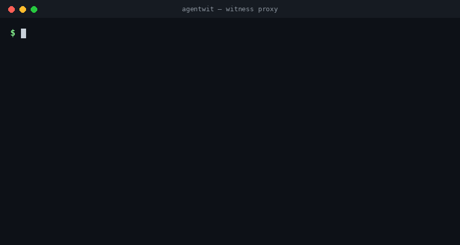

# agentwit

**Debug and audit AI agent ↔ MCP server tool calls.**

<p align="center">
  
</p>

```bash
pip install agentwit
agentwit proxy --target http://localhost:3000 --port 8765
```

```
[agentwit] 14:32:01  tools/call  bash       HIGH ⚠  shell_exec
[agentwit] 14:32:03  tools/call  read_file  LOW  ✓
[agentwit] 14:32:05  tools/call  bash       CRITICAL 🚨 privilege_escalation  LLM06
```

Change one URL. No MCP server modification needed.

[日本語版](README.ja.md) · [PyPI](https://pypi.org/project/agentwit/) · [Releases](https://github.com/tokotokokame/agentwit/releases)

[](https://www.python.org/)
[](https://pypi.org/project/agentwit/)
[](#)
[](LICENSE)
[](docs/api-reference.md#owaspmapper)
[](docs/plugin-guide.md)

---

## 🆕 What's new in v1.2.0 — Run it as a service

agentwit now runs resident instead of being watched in a GUI. Leave it in
front of your MCP server and it keeps a tamper-evident record, alerts you
where you already are, and is configured from one place.

```bash
pip install --upgrade agentwit
agentwit init                 # ~/.agentwit/config.yaml + secrets.env (0600)
agentwit daemon               # single process, ~60–70 MB RSS, loopback only
agentwit ui                   # local settings console (127.0.0.1)
```

- **Resident daemon** — one process, hot-reloads config on `SIGHUP`,
  graceful stop. systemd user unit and macOS LaunchAgent under
  [`packaging/`](packaging/), with memory/CPU caps and hardening.
- **Notifications** — Slack, Discord, generic webhook and email/SMTP, with
  per-route severity routing and a rate limit. Alerts reach your phone; so do
  `agentwit summary` pushes.
- **Settings console** — `agentwit ui`: a loopback-only page to toggle
  detection rules, manage destinations, and review recent detections.
- **Secrets stay local** — credentials live only in `~/.agentwit/secrets.env`
  (0600). Config and the console show just `${env:NAME}` references, and
  secrets are kept out of the witness log and the process logs.

The MCP Inspector desktop GUI is still available (`agentwit gui`); see
[MCP Inspector GUI](#mcp-inspector-gui) below.

---
## The problem

When an AI agent calls MCP server tools, **you can't see what's happening.**

```
AI Agent
↓  (black box)
MCP Server  →  bash / read_file / fetch / ...
```

agentwit sits between them as a transparent proxy and records everything.

```
AI Agent
↓
agentwit  ←  logs every call · detects risks · verifies integrity
↓
MCP Server  (zero modification)
```

---

## 5-minute quickstart

```bash
pip install agentwit

# 1. Create config + secrets (nothing secret ships in the package)
agentwit init

# 2. Point it at your MCP server, then run it resident
agentwit config set proxy.target http://localhost:3000
agentwit daemon                    # or: agentwit proxy --target http://localhost:3000

# 3. Point your agent to port 8765 instead of 3000. Recording starts immediately.

# 4. Audit report + integrity check
agentwit report --session ./witness_logs/SESSION_ID --format html
agentwit verify --session ./witness_logs/SESSION_ID
# Chain integrity:  VALID ✓   Signature check:  VALID ✓
```

Run it next to the MCP server so all traffic stays on loopback — no extra
port to open. To reach the console or proxy from another machine, tunnel over
SSH (`ssh -L 8765:127.0.0.1:8765 your-server`).

→ Full guide: [docs/quickstart.md](docs/quickstart.md) · service setup:
[packaging/README.md](packaging/README.md)

---

## Features

### Resident service *(v1.2.0)*
- `agentwit daemon` — single process (one thread at idle, no children,
  ~60–70 MB RSS). Edit config and `kill -HUP` (or `systemctl --user reload`)
  to apply monitor/notify changes without dropping the socket.
- systemd user unit and macOS LaunchAgent in [`packaging/`](packaging/) with
  `MemoryMax`, `CPUQuota`, `ProtectSystem=strict`, loopback+outbound sockets.

### Configuration & secrets *(v1.2.0)*
- One place: `~/.agentwit/config.yaml` (0644, no secrets) + `secrets.env`
  (0600). `agentwit init`, `agentwit config get|set|validate`.
- Credentials are referenced as `${env:NAME}` and resolved from env or
  `secrets.env`; nothing secret is written to config, the console, or logs.

### Settings console *(v1.2.0)*
- `agentwit ui` — loopback-only page: toggle rules, limit scored tools,
  manage notification destinations (secret-safe), review recent detections,
  live `config.yaml` preview. CSRF token delivered via URL fragment; the API
  never returns secret values.

### Notifications *(v1.2.0)*
- Slack, Discord, generic webhook, email/SMTP. Per-route severity routing and
  a per-minute rate limit. SSRF guards (https + host allow-list for webhooks;
  blocked ranges for SMTP). Untrusted fields are sanitized before sending.
- `agentwit summary [--push]` and an optional daemon end-of-session push so a
  phone sees activity without opening the console.
- Editing `notify.routes` by hand or via `config set`? Quote the severity
  key: `"on": [HIGH, CRITICAL]`. Written bare (`on: [...]`), YAML reads it as
  the boolean `True`, not the string `"on"` — `config validate`/`config set`
  now reject that explicitly instead of saving a route that never fires.

### Log recording
- Tamper-proof SHA-256 chain — detect any modification
- ed25519 signatures — prove who recorded the log
- HTML / Markdown / JSON report generation
- Auto-backup to `~/.agentwit/backups/` on session end
- Secret redaction before write: key-name based **and** value scanning for
  high-confidence secrets (Bearer/Authorization, AWS/GitHub/OpenAI/Slack
  tokens, JWT, webhook URLs, PEM keys)

### Risk detection
- 15+ built-in patterns: `shell_exec`, `privilege_escalation`, `data_exfiltration`, `jailbreak`, ...
- Prompt injection detection (CRITICAL/HIGH/MEDIUM/LOW)
- Tool schema change detection
- Agent thought & reasoning recording (LangChain)

### OWASP LLM Top 10 mapping *(v1.0.0)*

Every detected risk is automatically tagged with the corresponding OWASP LLM category:

| OWASP LLM | Category | Detected patterns |
|---|---|---|
| LLM01 | Prompt Injection | `instruction_override` / `role_hijack` / `jailbreak` |
| LLM02 | Sensitive Info Disclosure | `credential_access` / `data_exfiltration` |
| LLM06 | Excessive Agency | `privilege_escalation` / `persistence` / `lateral_movement` |
| LLM08 | Integrity Failures | `tool_schema_change` / `proxy_bypass_detected` |
| LLM10 | Unbounded Consumption | `call_rate_anomaly` / `session_cost_exceeded` |

```python
from agentwit.analyzer.owasp_mapper import OWASPMapper
mapper = OWASPMapper()
mapper.map("privilege_escalation")  # → "LLM06"
mapper.map_events(events)           # → adds owasp_category to each event
```

### Plugin API *(v1.0.0)*

Add custom detection rules as external packages — no fork needed:

```python
# my_package/plugin.py
from agentwit.plugins.base import PluginBase

class MyPlugin(PluginBase):
    def scan(self, event: dict) -> list[dict]:
        if "dangerous_pattern" in str(event):
            return [{"pattern": "my_pattern", "severity": "HIGH",
                     "description": "Custom detection"}]
        return []
```

```toml
# pyproject.toml of your plugin package
[project.entry-points."agentwit.plugins"]
my_plugin = "my_package:MyPlugin"
```

```bash
pip install agentwit-plugin-myname
agentwit proxy --target http://localhost:3000 --port 8765
# → plugin auto-loaded on startup
```

→ Full guide: [docs/plugin-guide.md](docs/plugin-guide.md)

### SIEM integration *(v1.0.0)*

Forward audit logs to Splunk, Elasticsearch, or Grafana Loki via Fluent Bit:

```bash
# docker/docker-compose.siem.yml
SPLUNK_HEC_TOKEN=your-token docker compose -f docker/docker-compose.siem.yml up
```

Supports: Splunk HEC · Elasticsearch · Grafana Loki

### MCP Inspector GUI

Optional desktop app for interactive, real-time MCP server debugging — handy
at a workstation, separate from the resident daemon above. Launch with
`agentwit gui`, or download a build:

| OS | File |
|---|---|
| Linux | [.AppImage](https://github.com/tokotokokame/agentwit/releases) · `.deb` · `.rpm` |
| macOS | `.dmg` (Apple Silicon / Intel) |
| Windows | `.msi` |

→ [All releases](https://github.com/tokotokokame/agentwit/releases)

#### GUI features
- 3-pane layout: Server info + Tool list / Parameter editor + Response / History + Metrics + Compare
- **Export Report button** — generate HTML audit report from History tab with one click
- EN/JP language support
- Real-time risk score display

```
┌─────────────────┬──────────────────────┬─────────────────────┐
│  Server Info    │  Parameter Editor    │  History            │
│  ─────────────  │  ──────────────────  │  ─────────────────  │
│  Tools          │  {                   │  [Export Report]    │
│  ✓ bash   EXEC  │    "command": "ls"   │                     │
│  ✓ read   READ  │  }                   │  14:32 bash  HIGH   │
│  ✓ fetch  READ  │                      │  14:33 read  LOW    │
│                 │  [Execute]           │  14:34 bash  CRIT   │
└─────────────────┴──────────────────────┴─────────────────────┘
```

---

## Transports

| Transport | Status | How to use |
|---|---|---|
| Streamable HTTP | ✅ | `agentwit proxy --target http://localhost:3000` |
| SSE (legacy) | ✅ | auto-detected |
| stdio | ✅ | `agentwit proxy --stdio -- python mcp_server.py` |

---

## LangChain integration

```bash
pip install agentwit[full]
```

```python
from agentwit import AgentwitCallback

callbacks = [AgentwitCallback(output="./audit.jsonl")]

# Agent thoughts and reasoning are also recorded:
# {"type": "agent_thought", "thought": "...", "tool_selected": "bash",
#  "reasoning": "...", "timestamp": "..."}
```

---

## CLI reference

```bash
# Setup & config
agentwit init
agentwit config set proxy.target http://localhost:3000
agentwit config get monitor
agentwit config validate

# Run resident (recommended) or one-shot proxy
agentwit daemon
agentwit proxy --target http://localhost:3000 --port 8765
agentwit proxy --stdio -- python mcp_server.py

# Settings console (loopback only)
agentwit ui

# Session summary (view, or push to Slack/Discord/email)
agentwit summary
agentwit summary --push

# Reports
agentwit report --session ./witness_logs/SESSION_ID --format json
agentwit report --session ./witness_logs/SESSION_ID --format markdown
agentwit report --session ./witness_logs/SESSION_ID --format html --output ./report.html

# Verification
agentwit verify --session ./witness_logs/SESSION_ID
agentwit replay --session ./witness_logs/SESSION_ID
agentwit diff --session-a ./witness_logs/A --session-b ./witness_logs/B
```

→ Full reference: [docs/api-reference.md](docs/api-reference.md)

---

## Guard vs. Witness

| Tool | Approach | Blocks calls | Tamper-proof log |
|---|---|---|---|
| mcp-scan | Proxy + Guard | ✅ | ❌ |
| Intercept | Policy proxy | ✅ | ❌ |
| **agentwit** | **Witness proxy** | **❌** | **✅** |

agentwit does not block. It **witnesses**.  
A blocked call leaves no trace. A witnessed call leaves evidence.

---

## Version history

| Version | Date | Highlights |
|---|---|---|
| v0.1.0 | 2026-03-14 | MVP: HTTP/SSE/stdio proxy, SHA-256 chain log |
| v0.2.0 | 2026-03-15 | HTML report, LangChain, Slack/Discord webhook |
| v0.3.0 | 2026-03-16 | MCP Inspector GUI, standard `/mcp` endpoint |
| v0.4.0 | 2026-03-21 | MCP spec auto-follow, injection detection, tool monitoring |
| v0.5.0 | 2026-03-22 | ed25519 signatures, bypass detection, anomaly detection |
| v0.6.0 | 2026-03-22 | GUI Export Report, agent thought recording, error handling |
| v0.7.0 | 2026-03-22 | OWASP LLM Top 10 mapping, Windows build (GitHub Actions) |
| v1.0.0 | 2026-03-22 | Plugin API, SIEM integration, full docs, GUI tests |
| v1.1.0 | 2026-03 | MCP Inspector desktop app (`agentwit gui`) |
| v1.2.0 | 2026-10-26 | Resident daemon, config+secrets layer, notification hub (Slack/Discord/email), settings console, value redaction, summary push, security review |
| **v1.2.1** | **2026-10-27** | **Hotfix: HTTP proxy 500 on real traffic, notify `on:` YAML footgun, tools/list false-positive alerts (found in live deployment)** |

---

## Documentation

| Doc | Contents |
|---|---|
| [docs/quickstart.md](docs/quickstart.md) | 5-minute getting started guide |
| [docs/architecture.md](docs/architecture.md) | Architecture and design philosophy |
| [docs/api-reference.md](docs/api-reference.md) | Full CLI and Python API reference |
| [docs/plugin-guide.md](docs/plugin-guide.md) | Plugin development guide |
| [CONTRIBUTING.md](CONTRIBUTING.md) | How to contribute |
| [CHANGELOG.md](CHANGELOG.md) | Full version history |

---

## License

MIT — see [LICENSE](LICENSE)
